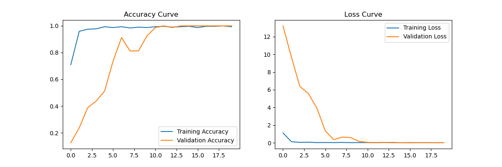
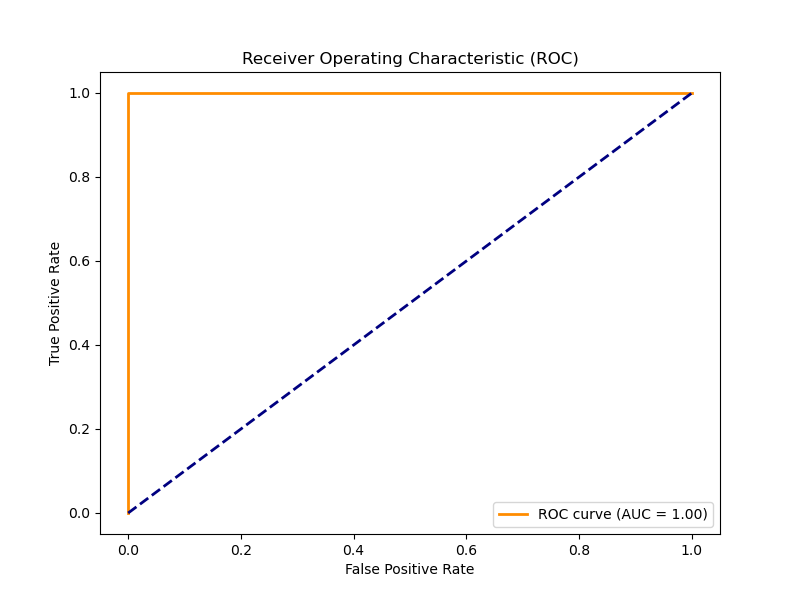
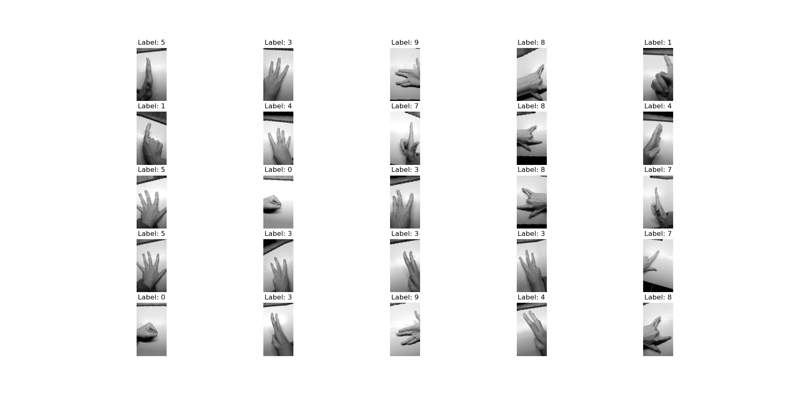

# 基于卷积神经网络的阿拉伯数字手势识别

> 深圳大学《机器学习》课程期末大作业 · 2023 年秋季学期
> 作者：江浩天（22 级生物医学工程创新班）

用手持设备自行拍摄的 0–9 手势视频构建数据集，训练卷积神经网络完成**十分类**手势识别；随后把任务改写为**二分类**（数字 0 为正类，其余为负类）重新训练，并用混淆矩阵、灵敏性 / 特异性与 ROC–AUC 做完整评估。

---

## 结果速览

| 任务 | 评价指标 | 结果 |
| --- | --- | --- |
| 十分类（0–9） | Accuracy | **0.99** |
| 十分类（0–9） | Macro F1 | **0.99** |
| 二分类（0 vs 1–9） | Accuracy | **1.00** |
| 二分类（0 vs 1–9） | Sensitivity / Recall | **1.00** |
| 二分类（0 vs 1–9） | Specificity | **1.00** |
| 二分类（0 vs 1–9） | AUC | **1.00** |

十分类测试集（100 张）中，类别 0–7 与 9 全部识别正确，仅类别 8 有 1 张被误判（recall 0.89），类别 9 的 precision 为 0.94。二分类测试集混淆矩阵为 TN = 89、FP = 0、FN = 0、TP = 11。

| 训练曲线（十分类） | ROC 曲线（二分类） |
| --- | --- |
|  |  |

---

## 数据集

数据集完全由自己拍摄，没有使用公开数据：

- **采集**：用高清摄像设备录制 10 段手势视频（`gesture_0.mp4` … `gesture_9.mp4`，1920×1080），文件名的数字即手势标签；每段视频覆盖不同角度、位置与手指姿态（伸直 / 微曲），以增加类内多样性。
- **抽帧**：`data_process.py` 用 OpenCV 逐帧读取，每段视频取前 50 帧，转灰度并缩放到高度 100 像素（宽度按原始宽高比缩放），再把像素展平写成 CSV（一行 = 一帧，第一列为 label）。
- **规模**：10 段视频 × 50 帧 ≈ **500 张** 100×177 灰度图，类别基本均衡。
- **划分**：`train_test_split(test_size=0.2, random_state=42)`，测试集 100 张，训练时再从训练集切 20% 作验证集。

抽取后的增强样本示例（`Label` 为手势数字）：



---

## 方法

### 网络结构

两个任务的骨干网络完全一致，只有输出层不同：

```
输入 100×177×1（灰度）
 ├─ Conv2D(32, 3×3, ReLU) → MaxPool2D(2×2) → BatchNorm
 ├─ Conv2D(64, 3×3, ReLU) → MaxPool2D(2×2) → BatchNorm
 ├─ Conv2D(128, 3×3, ReLU) → MaxPool2D(2×2) → BatchNorm
 ├─ Flatten
 ├─ Dense(128, ReLU) → Dropout(0.5)
 └─ 十分类：Dense(10, Softmax)      二分类：Dense(1, Sigmoid)
```

卷积核数量随深度递增（32 → 64 → 128），每个卷积块后接最大池化与批归一化；全连接层用 Dropout(0.5) 抑制过拟合。

### 训练配置

| 项目 | 设置 |
| --- | --- |
| 优化器 | Adam |
| 损失函数 | 十分类 `categorical_crossentropy` / 二分类 `binary_crossentropy` |
| Batch size | 32 |
| Epochs | 20 |
| 数据增强 | 缩放 0.2、平移 0.1、旋转 20°、剪切 0.2、亮度 0.7–1.3、水平翻转 |

---

## 目录结构

```
gesture-recognition-cnn/
├── data_process.py     # 视频抽帧 → 灰度/缩放 → 像素 CSV，并做数据增强可视化
├── multiclass_cnn.py   # 十分类任务：训练、分类报告、混淆矩阵、准确率/损失曲线
├── binary_cnn.py       # 二分类任务：训练、灵敏性/特异性、ROC-AUC
├── dataset/            # 自行拍摄的 10 段手势视频（原始数据）
├── gesture_recognition_model.h5            # 十分类模型权重
├── gesture_binary_classification_model.h5  # 二分类模型权重
└── docs/
    ├── 机器学习期末大作业报告.doc   # 课程报告（含完整推导与代码附录）
    ├── 手势识别论文.docx           # 论文格式整理稿
    └── figures/                    # 训练曲线、ROC 曲线、增强样本
```

> 原工程中的 `main1.py` / `main2.py` 在本仓库中分别重命名为 `multiclass_cnn.py` / `binary_cnn.py`，代码逻辑未改动。

---

## 快速开始

```bash
pip install -r requirements.txt

# 1) 视频抽帧，生成 dataset_csv/（可重复生成，未纳入版本库）
python data_process.py

# 2) 十分类训练与评估
python multiclass_cnn.py

# 3) 二分类训练与评估
python binary_cnn.py
```

脚本以相对路径读取 `./dataset/` 与 `./dataset_csv/`，请在仓库根目录下运行。训练完成后模型权重默认写回当前目录（即 `gesture_recognition_model.h5` 与 `gesture_binary_classification_model.h5`）。

---

## 实验结论与局限

- 数据量仅约 500 张、且取自单人固定场景，测试集只有 100 张，因此 99% 的准确率更多说明**在小规模封闭集上 CNN 能很好拟合手势轮廓**，不足以代表跨人、跨光照的泛化能力。
- 二分类任务的 Acc / Sens / Spec / AUC 同时为 1.00，是数据可分性极强与正类仅 11 个测试样本共同作用的结果，指标已接近上限，对模型优劣的区分度有限。
- 后续可扩展的方向：增加拍摄者与光照条件、使用迁移学习（如 MobileNetV2）、引入时序模型（3D CNN / LSTM）直接建模动作过程。

---

## 文档

- [`docs/机器学习期末大作业报告.doc`](docs/机器学习期末大作业报告.doc)：完整实验报告，含数据集统计、网络结构逐层说明、分类报告与混淆矩阵原始输出。
- [`docs/手势识别论文.docx`](docs/手势识别论文.docx)：论文格式的精简稿。

*本项目为本科课程作业，仅用于学习与交流。*
